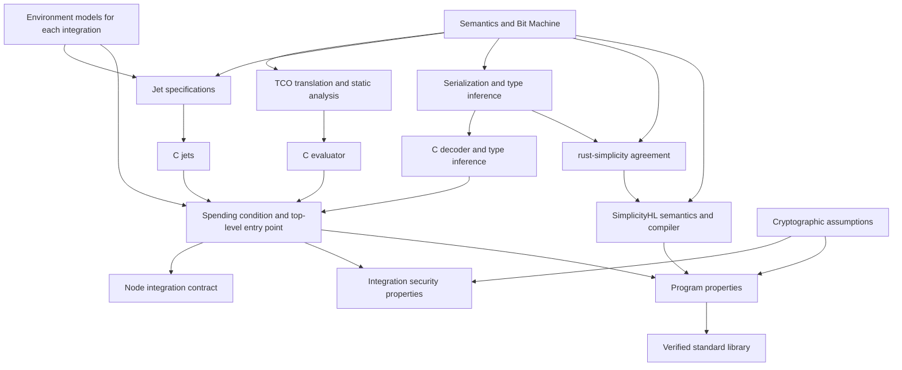

# Formal verification roadmap

The end goal is a machine-checked chain from Simplicity's formal semantics to
the behavior of the nodes that enforce it. Every layer of the implementation
should be proved against the layer above, so that a proof about a program's
denotation says exactly which transactions the node accepts. Proofs use Coq,
with VST for the C code. The production compiler and the standard C library
are trusted, and verifying them is out of scope.

This page gives an overview. For file locations, the exact conditions on each
result, and known mismatches, see the
[verification status reference](VERIFICATION-STATUS.md).

## Structure

The specification layer comes first: everything below it is proved against
it. Proofs about the denotation of individual programs can start at any
time, but they only become statements about node behavior once the
spending-condition chain is complete.

## Goals and status

Rows are grouped by area, and their order doesn't indicate priority.

| Area | Goal | Status |
| --- | --- | --- |
| Specification | Denotational semantics of Simplicity | Done for the core language and its extensions |
| | Bit Machine | Done |
| | Translation to the Bit Machine | Naive translation done for core Simplicity; extensions and TCO translation not started |
| | Static analysis | Memory bound done for the naive translation of core Simplicity; TCO memory bounds, cost, and frame count not started |
| | Serialization, type inference, and anti-malleability rules | Not started |
| | Environment model for each integration | An early Bitcoin model; Elements model on a branch, unreviewed |
| | Jet specifications | Complete in Haskell; Coq transcriptions on a branch; Coq jet library not started |
| | Jet characterizations usable in program proofs | Done for word adders and multipliers; otherwise not started |
| | Agreement with external standards, for the jets that implement one | Done for SHA-256 block compression; otherwise not started |
| C implementation | Jets | All 533 covered on a branch, with conditions; one proved non-conforming |
| | Step bounds supporting each jet's cost | Not started |
| | Evaluator | Not started |
| | Decoder and type inference | Not started |
| Integration | Formal specification of each integration (the spending condition and the node's checks) | Not started |
| | Transaction environment construction | Not started |
| | Top-level entry point | Not started |
| | Node-side interface contract | Not started |
| | Security properties, such as program binding and signature coverage | Not started |
| | Representation of cryptographic assumptions | Used only for three conditional jet results |
| Other implementations | rust-simplicity agreement with the C library | Differential fuzzing of decoding, type checking, and Merkle roots |
| | SimplicityHL semantics and compiler correctness | Not started |
| | Correctness of optimizations | Not started |
| Programs | Properties of Simplicity programs | Possible now; examples for arithmetic and SHA-256 |
| | Properties of SimplicityHL programs | Depends on compiler correctness |
| | Properties spanning multiple transactions | Not started |
| | Reusable lemmas and example contracts | Not started |
| | Verified SimplicityHL standard library | Not started |

## Key open issues

- The newest jet proofs are on the
  [`feat/jet-equivalence`](https://github.com/brenorb/simplicity/tree/feat/jet-equivalence)
  branch, which hasn't been reviewed or merged. They apply to the C code at
  commit `e3b6701`.
- `gej_ge_add_ex` doesn't match its specification. The specification will
  change to match the deployed C code, and the jet's CMR will keep its current
  value.
- The proofs of the secp256k1 code cover libsecp256k1's int128 emulation on
  x86-64 Linux. GCC and Clang builds use native 128-bit integers instead.
- The specifications of record are in Haskell. Coq doesn't yet have a jet
  library or a model of either current integration's environment that matches
  the Haskell definitions.
- rust-simplicity reimplements consensus-relevant logic. SimplicityHL relies
  on it for Merkle roots, encoding, type inference, and cost analysis, and
  only some of these are compared with the C library.
